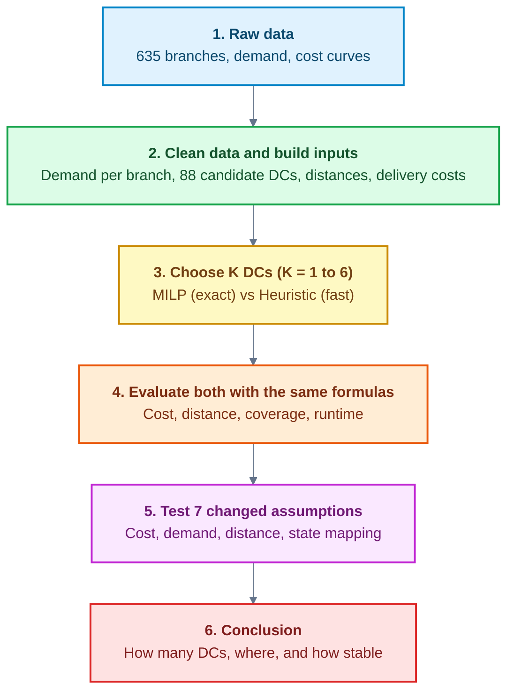

# Research-K25-Team-2
This study examines how many distribution centers (DCs) an Australian retailer should open, and where, to balance transport cost, delivery distance, and inventory. Opening more DCs brings products closer to branches, but it also increases total inventory, so the goal is a reasonable balance rather than the minimum of any single measure. We use and compare two methods, a fast heuristic and an exact mixed-integer linear programming (MILP) model, to see how close the heuristic gets to the optimal solution. We also test whether the recommended network stays stable when key assumptions change.

## Flowchart

